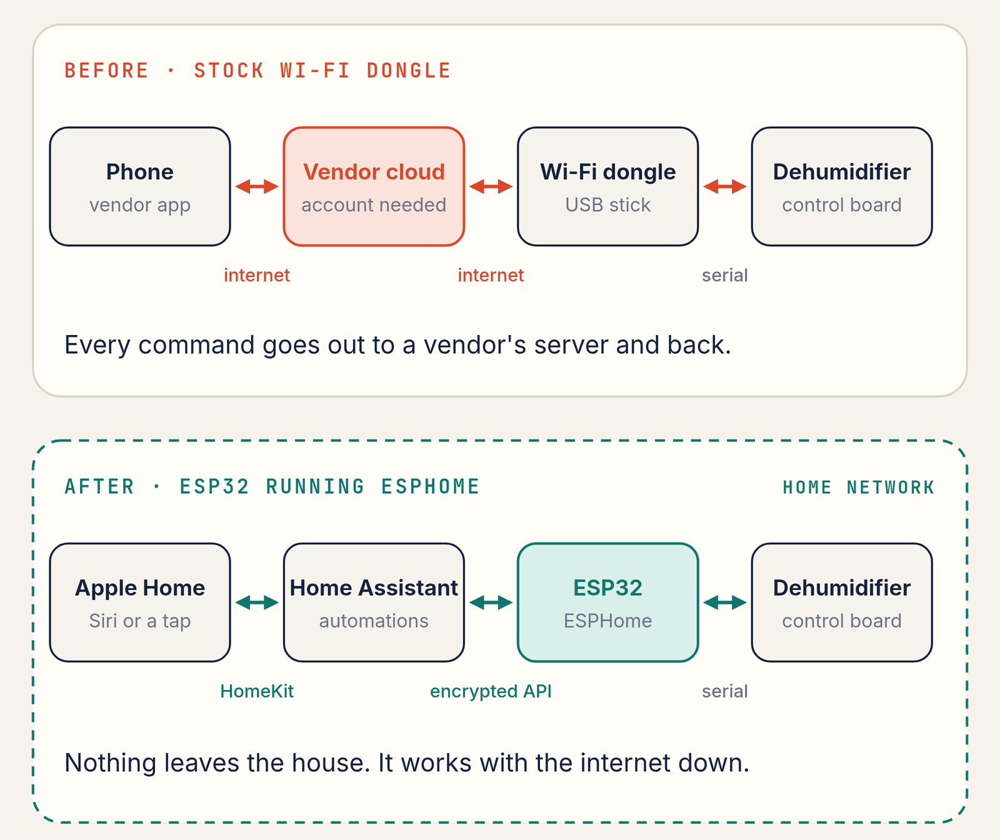
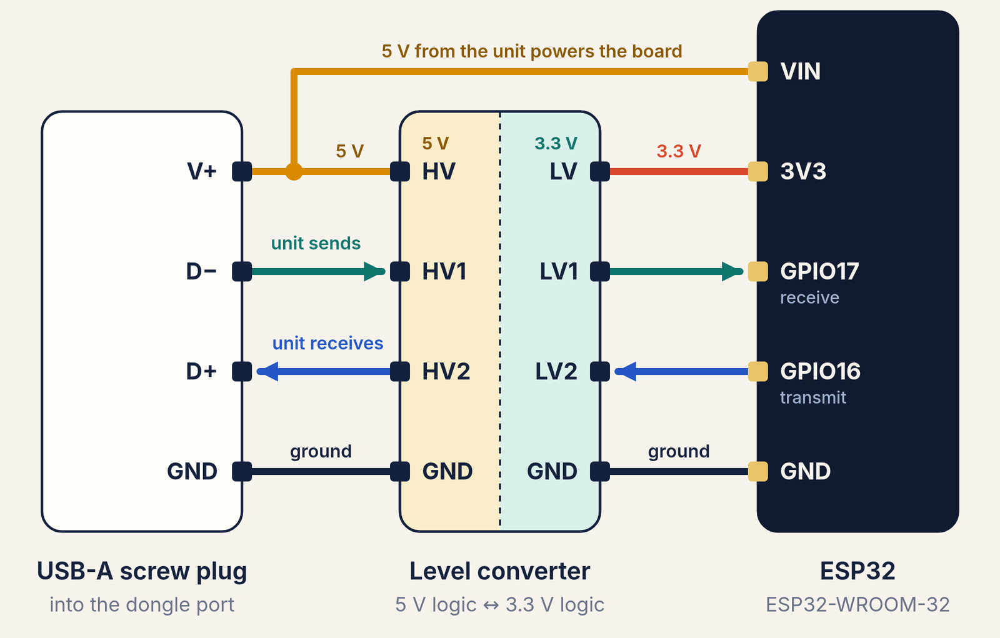
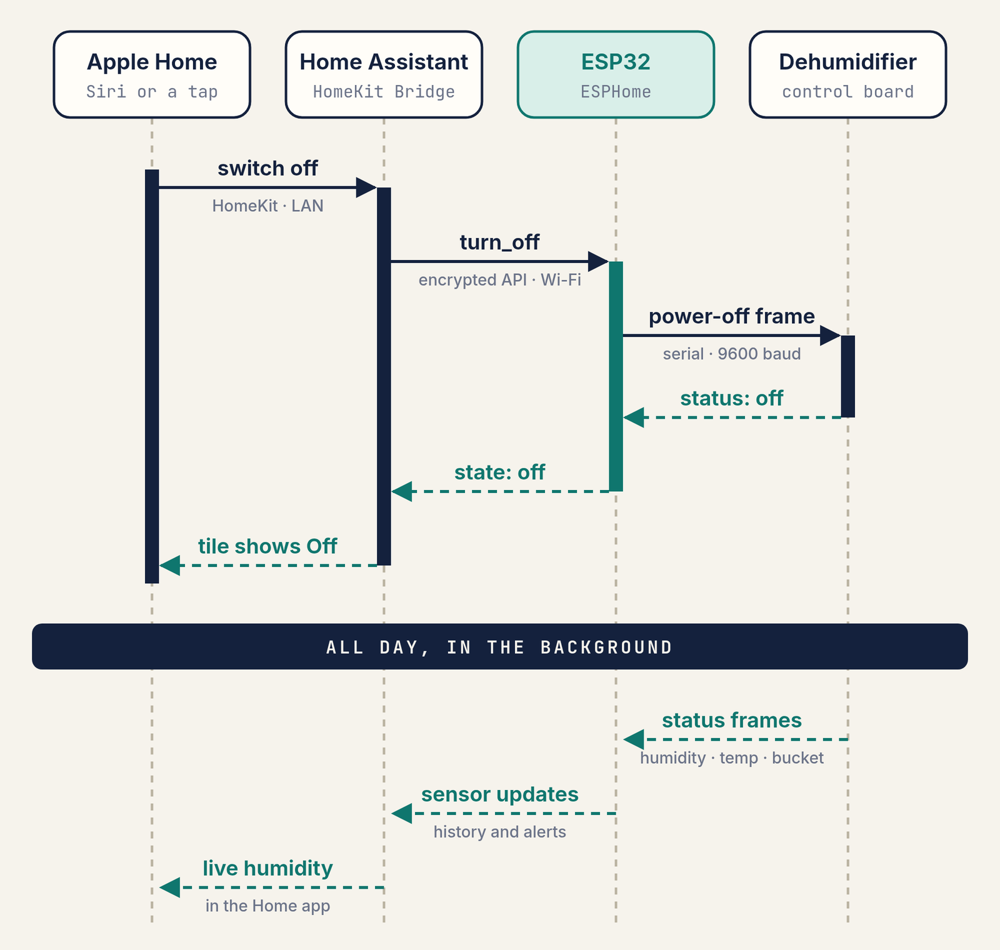
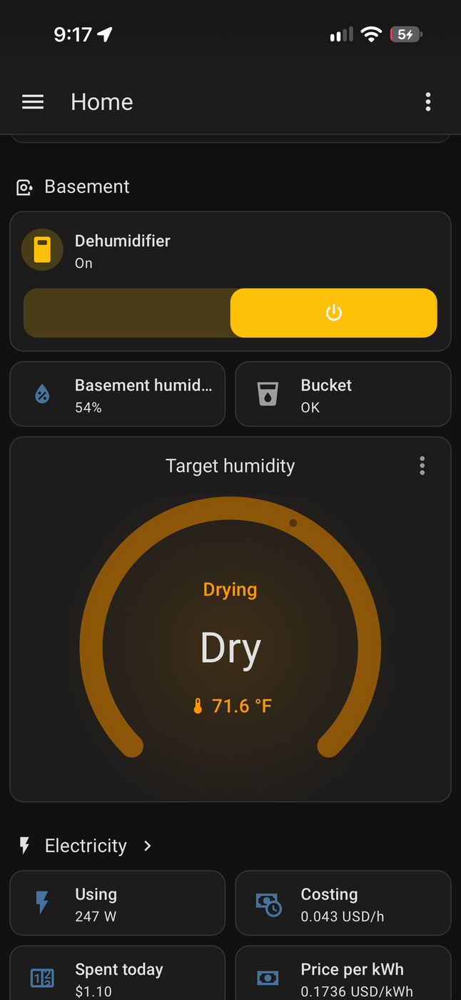
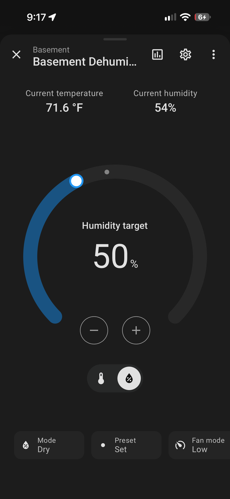
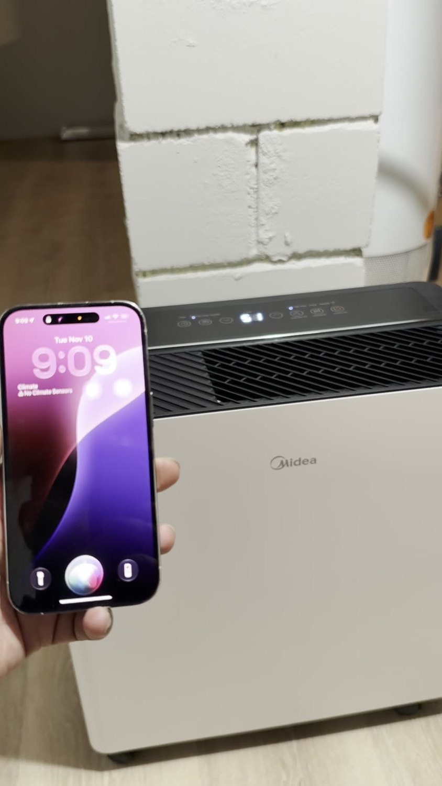
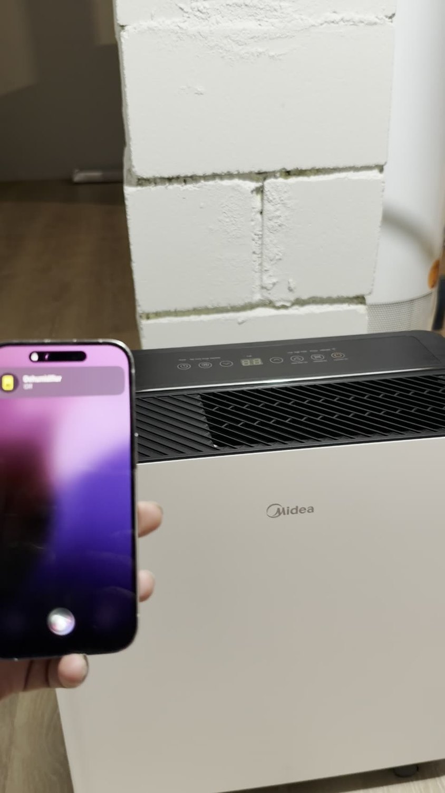

# A Midea dehumidifier, off the cloud

I replaced the Wi-Fi dongle in my Midea **MAD50PS1BWT-C** dehumidifier with an ESP32 running
[ESPHome](https://esphome.io/). It now answers to [Home Assistant](https://www.home-assistant.io/) and Apple Home
over my own network, with no vendor app, no account and no cloud. Nothing on the unit was cut or soldered, and the
stock dongle plugs straight back in.

This repo holds the wiring, the ESPHome config, the Home Assistant packages, and the photos and diagrams from the
build. The slides I made about it are in [`docs/dehumidifier-off-the-cloud.pdf`](docs/dehumidifier-off-the-cloud.pdf).

<p align="center">
  
  
</p>

## Why

The stock dongle ties the dehumidifier to the vendor's app and an account, and every command goes out to a server
and back. I wanted the unit in the same place as everything else in the house, with the automations I choose, and
still working when the internet is down.



## What it does now

- On and off from Apple Home, Siri, Home Assistant or the unit's own buttons, and all of them stay in step.
- Target humidity, mode (Set, Continuous, Smart, Dry) and fan speed from Home Assistant.
- Live humidity and temperature, with history.
- A phone notification when the bucket is full, and another when the basement stays more than 5 points above the
  target for 2 hours.
- The target goes up 5 points during my utility's on-peak hours (weekdays 6 to 9 pm) and back afterwards.
- Firmware updates over Wi-Fi.


## Parts

| Part | What I used | Link |
|---|---|---|
| Dehumidifier | Midea MAD50PS1BWT-C, 50 pint, built-in pump | [Costco](https://www.costco.com/p/-/midea-smart-50-pint-dehumidifier-with-built-in-pump/4000437929) |
| ESP32 dev board | Inland ESP32-WROOM-32, USB-C (`esp32dev`) | [Micro Center (search)](https://www.microcenter.com/search/search_results.aspx?Ntt=inland+esp32) |
| Logic level converter | 4-channel, BSS138, 5 V to 3.3 V | generic; the same part at [Adafruit](https://www.adafruit.com/product/757) and [SparkFun](https://www.sparkfun.com/products/12009) |
| USB-A male plug with screw terminals | generic, 4 terminals | a similar one at [Adafruit](https://www.adafruit.com/product/3628) |
| Jumper wires | ELEGOO dupont kit (9 wires used) | [ELEGOO](https://us.elegoo.com/products/elegoo-multicolored-dupont-wire-kit) |
| Heat-shrink tubing | Electro Bits assorted, black | [Micro Center (search)](https://www.microcenter.com/search/search_results.aspx?Ntt=electro+bits+heat+shrink) |
| Multimeter | Hyper Tough digital multimeter | [Walmart (search)](https://www.walmart.com/search?q=hyper+tough+digital+multimeter) |
| Short USB-A extension cable | generic | any |

Software: [ESPHome](https://esphome.io/), [Home Assistant](https://www.home-assistant.io/) with its
[HomeKit Bridge](https://www.home-assistant.io/integrations/homekit/), and the `midea_dehum` component from
[Chreece/ESPHome-Dehumidifier](https://github.com/Chreece/ESPHome-Dehumidifier) (Apache-2.0).

<p align="center">
  
  
</p>

## Measure before you wire

The dongle port looks like USB, but it isn't. It carries **5 V serial data at 9600 baud**. The guide I followed
numbers the power pins the opposite way to my unit, so wiring by pin number would have fed the board backwards.

With the screw-terminal plug in the port and nothing else connected, I metered **+5.04 V on the plug's V+ screw**
against the − screw. So on this model the power is on the standard USB pins. Go by the labels on the plug, and check
your own unit with a meter before connecting anything.

The data lines are crossed compared with what the names suggest: **D− is the unit's TX** and **D+ is its RX**.

<p align="center">
  
</p>

## Wiring

The unit talks at 5 V and the ESP32's pins are 3.3 V only, so a level converter sits between them. The ESP32 is
powered from the unit's own 5 V, so there's no extra plug. No solder: the male jumper ends go under the plug's
screws, and the female ends push onto the header pins.



| # | From | To |
|---|---|---|
| 1 | ESP32 `3V3` | converter `LV` |
| 2 | ESP32 `GND` | converter `GND` (LV side) |
| 3 | ESP32 `GPIO17` (RX) | converter `LV1` |
| 4 | ESP32 `GPIO16` (TX) | converter `LV2` |
| 5 | converter `HV1` | plug `D−` (the unit's TX) |
| 6 | converter `HV2` | plug `D+` (the unit's RX) |
| 7 | converter `GND` (HV side) | plug `−` |
| 8 | converter `HV` | plug `V+` |
| 9 | ESP32 `VIN` | plug `V+` (the same screw as 8) |

If no data comes through (the "Protocol Version" sensor stays empty and everything else shows unavailable), swap the
two data wires. It's the usual mistake.

## Firmware

The config is [`esphome/basement-dehumidifier.yaml`](esphome/basement-dehumidifier.yaml). Copy
[`secrets.example.yaml`](esphome/secrets.example.yaml) to `secrets.yaml` next to it and fill it in.

Flash it once over USB, **before** wiring the board to the dehumidifier:

```sh
cd esphome
esphome run basement-dehumidifier.yaml
```

Or build the image and write it with esptool, which is how I did it:

```sh
esphome compile basement-dehumidifier.yaml
esptool --chip esp32 --port /dev/ttyUSB0 --baud 460800 write-flash 0x0 \
  .esphome/build/basement-dehumidifier/build/firmware.factory.bin
```

(On a Mac the port is `/dev/cu.usbserial-*` or `/dev/cu.SLAB_USBtoUART`; on Windows `COM3` or similar. If the upload
waits on "Connecting", hold the board's BOOT button until it starts.)

After that:

1. Wire it up as above, plug it into the dongle port and power the unit on.
2. Home Assistant finds it under **Settings → Devices & services → Discovered**. Add it with the API key from
   `secrets.yaml`.
3. Later updates go over Wi-Fi: `esphome run basement-dehumidifier.yaml` again and pick the network device.

If the board can't join the Wi-Fi it opens a hotspot named **Basement-Dehumidifier**; join it from a phone and the
captive portal asks for the Wi-Fi details.

### Notes for this model

- Protocol auto-detect found **V2**. The config pins it (`protocol_version: 2`) so boot doesn't wait on detection.
- The unit reports these capabilities: fan speed, filter reminder, drain pump, ionizer, auto humidity control and
  clothes drying. It has no swing, PM2.5 sensor or tank level, so those aren't in the config.
- The component is pinned to a commit, so an upstream change can't alter the firmware without me choosing it.

## The build

**Unplug the dehumidifier before opening it.** Many of these units use R290 (propane) refrigerant, so stay away from
the sealed system.

<p align="center">
  
  
  
</p>

1. Top cover off. The stock dongle is a white USB stick; pull it out and keep it.
2. Plug a short USB extension into the port and the screw-terminal plug into that, so nothing hangs off the port.
3. One wide piece of heat-shrink goes over the level converter and the screw block together, shrunk with a hair
   dryer.
4. Route the wires along the frame, clear of the blower wheel. The ESP32 sits in the cavity beside it.
5. Cover back on. From the outside nothing has changed.

## Home Assistant and Apple Home

[`homeassistant/packages/dehumidifier.yaml`](homeassistant/packages/dehumidifier.yaml) has the on/off switch that
Apple Home gets, and the two alerts.
[`homeassistant/packages/dehumidifier_onpeak.yaml`](homeassistant/packages/dehumidifier_onpeak.yaml) raises the
target during on-peak hours and puts it back.
[`homeassistant/homekit.yaml`](homeassistant/homekit.yaml) is the HomeKit Bridge entry.

Why a switch and not a dehumidifier tile: HomeKit shows a Home Assistant climate entity as a thermostat, which would
be wrong, so Apple Home gets an honest on/off switch and a humidity sensor. The switch reads its state from the
unit, so pressing the power button on the panel flips the tile in Apple Home too. Mode, fan and target stay in Home
Assistant.

The on-peak automation is careful about three things: it never raises a target that is already at 56% or higher, it
leaves alone a target someone changed by hand in the meantime, and it puts the target back after a Home Assistant
restart if on-peak ended while it was down.



<p align="center">
  
  
  
</p>

Asking Siri, with the unit's display following:

<p align="center">
  
  
  
</p>

## Credits

- [Chreece (Christos Baltatzidis)](https://github.com/Chreece), who wrote and maintains
  [ESPHome-Dehumidifier](https://github.com/Chreece/ESPHome-Dehumidifier), the ESPHome component this runs on.
- [Zane Pickett (sirwolfgang)](https://github.com/sirwolfgang), who added the component's V2 protocol support
  ([#44](https://github.com/Chreece/ESPHome-Dehumidifier/pull/44)). This unit speaks V2, so that's the code it runs.
- [Hypfer](https://github.com/Hypfer), whose [esp8266-midea-dehumidifier](https://github.com/Hypfer/esp8266-midea-dehumidifier)
  worked out the protocol the component was ported from.
- [CDank](https://github.com/CDank), [Joseph Jon Booker](https://github.com/sargas) and the component's other
  contributors.

Thank you all.

## License

[MIT](LICENSE). This is a record of what worked on my unit. Opening a mains appliance is at your own risk.
