# A Midea dehumidifier, off the cloud

I replaced the Wi-Fi dongle in my Midea **MAD50PS1BWT-C** dehumidifier with an ESP32 running
[ESPHome](https://esphome.io/). It now answers to [Home Assistant](https://www.home-assistant.io/) and Apple Home
over my own network, with no vendor app, no account and no cloud. Nothing on the unit was cut or soldered, and the
stock dongle plugs straight back in.

This repo holds the wiring, the ESPHome config, the Home Assistant packages, and the photos and diagrams from the
build. The slides I made about it are in [`docs/dehumidifier-off-the-cloud.pdf`](docs/dehumidifier-off-the-cloud.pdf).

<p align="center">
  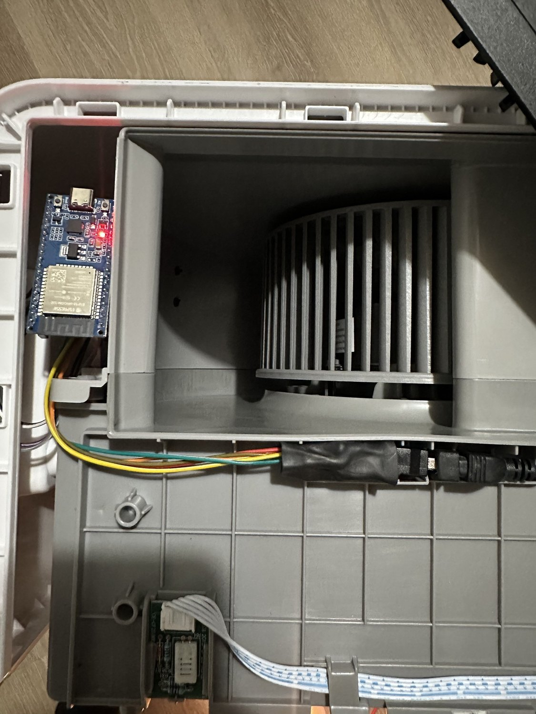
  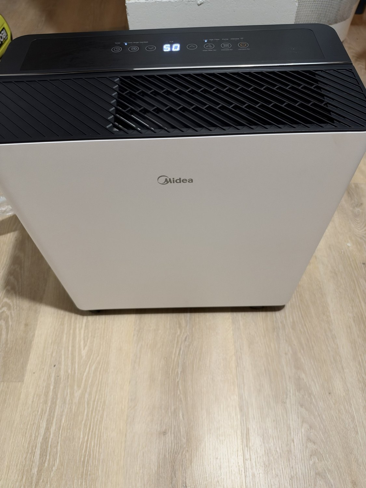
</p>

## Why

The stock dongle ties the dehumidifier to the vendor's app and an account, and every command goes out to a server
and back. I wanted the unit in the same place as everything else in the house, with the automations I choose, and
still working when the internet is down.


## What it does now

- On and off from Apple Home, Siri, Home Assistant or the unit's own buttons, and all of them stay in step.
- Target humidity, mode (Set, Continuous, Smart, Dry) and fan speed from Home Assistant.
- Live humidity and temperature, with history.
- It runs in long, cheap runs instead of short-cycling (below): overnight at my utility's off-peak price, only when
  the house holds moisture, and off as soon as the basement reaches 50%. It never runs in on-peak hours.
- A phone notification when the bucket is full, and another when the basement stays over 62% for 3 hours.
- Firmware updates over Wi-Fi.

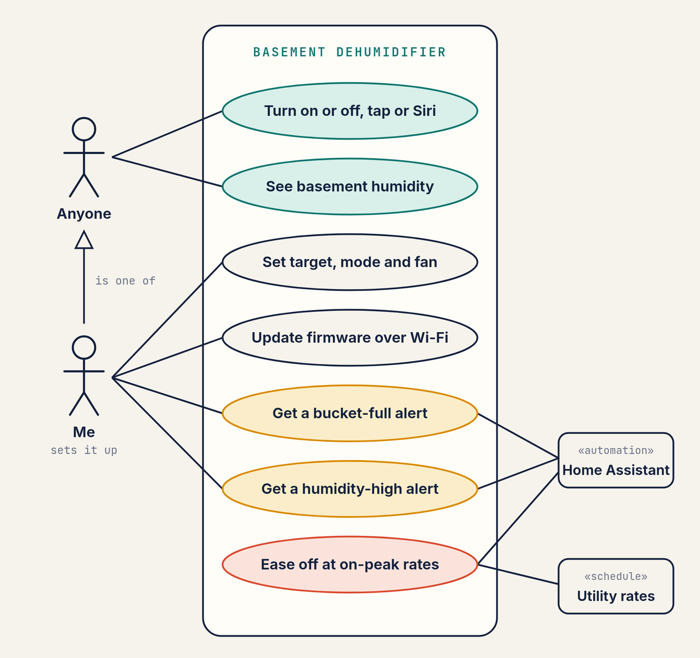

## Parts

| Part | What I used | Link |
|---|---|---|
| Dehumidifier | Midea MAD50PS1BWT-C, 50 pint, built-in pump | [Costco](https://www.costco.com/p/-/midea-smart-50-pint-dehumidifier-with-built-in-pump/4000437929) |
| ESP32 dev board | Inland ESP32-WROOM-32, USB-C (`esp32dev`) | [Micro Center](https://www.microcenter.com/product/704601/ESP32-WROOM_Core_Board_with_USB-C_WiFi_Bluetooth_Dual_Core_Microcontroller_for_Arduino) |
| Logic level converter | 4-channel, BSS138, 5 V to 3.3 V | [Amazon](https://www.amazon.com/dp/B0F7QPNR4K) |
| USB-A male plug with screw terminals | JUXINICE solderless, 4 terminals | [Amazon](https://www.amazon.com/dp/B09WYRNDDQ) |
| Jumper wires | ELEGOO 120-piece dupont kit (9 wires used) | [Amazon](https://www.amazon.com/dp/B01EV70C78) |
| Heat-shrink tubing | assorted sizes, black | [Micro Center](https://www.microcenter.com/product/689124/Assorted_Size_Black_Color_4_Heat_Shrink_Tubing_-_24_Pack) |
| Multimeter | Hyper Tough digital multimeter | [Walmart (search)](https://www.walmart.com/search?q=hyper+tough+digital+multimeter) |
| Short USB-A extension cable | generic | any |

Software: [ESPHome](https://esphome.io/), [Home Assistant](https://www.home-assistant.io/) with its
[HomeKit Bridge](https://www.home-assistant.io/integrations/homekit/), and the `midea_dehum` component from
[Chreece/ESPHome-Dehumidifier](https://github.com/Chreece/ESPHome-Dehumidifier) (Apache-2.0).

<p align="center">
  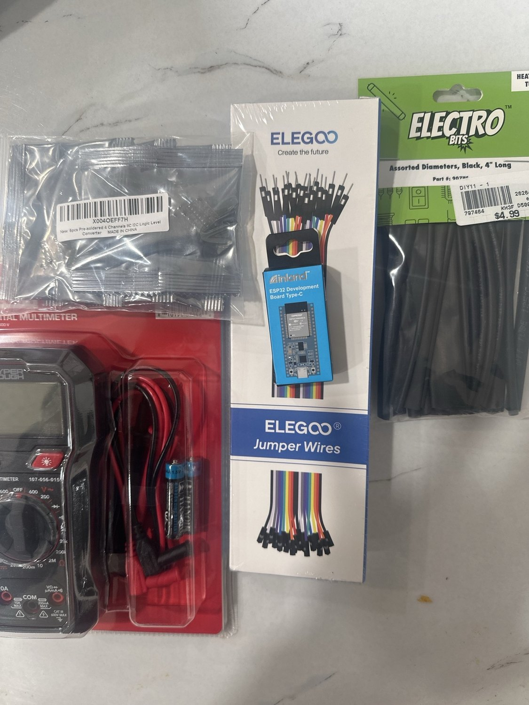
  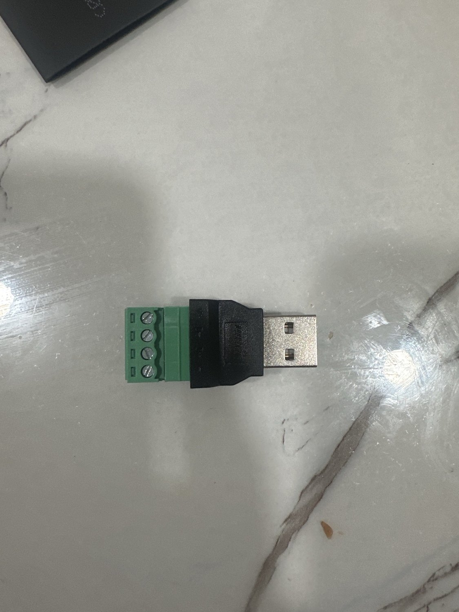
</p>

## Measure before you wire

The dongle port looks like USB, but it isn't. It carries **5 V serial data at 9600 baud**. The pin table I followed
at the time numbered the power pins the opposite way to the USB-A standard, so wiring by pin number would have fed
the board backwards. (The project's hardware guide has since been rewritten without pin numbers.) Measure first.

With the screw-terminal plug in the port and nothing else connected, I metered **+5.04 V on the plug's V+ screw**
against the − screw. So on this model the power is on the standard USB pins. Go by the labels on the plug, and check
your own unit with a meter before connecting anything.

The data lines are crossed compared with what the names suggest: **D− is the unit's TX** and **D+ is its RX**.

<p align="center">
  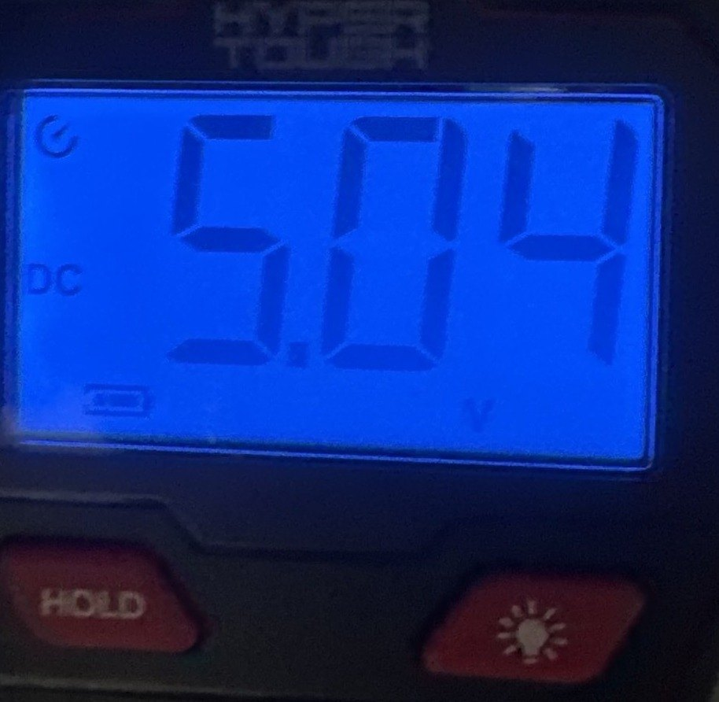
</p>

## Wiring

The unit talks at 5 V and the ESP32's pins are 3.3 V only, so a level converter sits between them. The ESP32 is
powered from the unit's own 5 V, so there's no extra plug. No solder: the male jumper ends go under the plug's
screws, and the female ends push onto the header pins.


| # | From | To |
|---|---|---|
| 1 | ESP32 `3V3` | converter `LV` |
| 2 | ESP32 `GND` | converter `GND` (LV side) |
| 3 | ESP32 `GPIO17` (RX) | converter `LV1` |
| 4 | ESP32 `GPIO16` (TX) | converter `LV2` |
| 5 | converter `HV1` | plug `D−` (the unit's TX) |
| 6 | converter `HV2` | plug `D+` (the unit's RX) |
| 7 | converter `GND` (HV side) | plug `−` |
| 8 | converter `HV` | plug `V+` |
| 9 | ESP32 `VIN` | plug `V+` (the same screw as 8) |

If no data comes through (the "Protocol Version" sensor stays empty and everything else shows unavailable), swap the
two data wires. It's the usual mistake.

## Firmware

The config is [`esphome/basement-dehumidifier.yaml`](esphome/basement-dehumidifier.yaml). Copy
[`secrets.example.yaml`](esphome/secrets.example.yaml) to `secrets.yaml` next to it and fill it in.

Flash it once over USB, **before** wiring the board to the dehumidifier:

```sh
cd esphome
esphome run basement-dehumidifier.yaml
```

Or build the image and write it with esptool, which is how I did it:

```sh
esphome compile basement-dehumidifier.yaml
esptool --chip esp32 --port /dev/ttyUSB0 --baud 460800 write-flash 0x0 \
  .esphome/build/basement-dehumidifier/build/firmware.factory.bin
```

(On a Mac the port is `/dev/cu.usbserial-*` or `/dev/cu.SLAB_USBtoUART`; on Windows `COM3` or similar. If the upload
waits on "Connecting", hold the board's BOOT button until it starts.)

After that:

1. Wire it up as above, plug it into the dongle port and power the unit on.
2. Home Assistant finds it under **Settings → Devices & services → Discovered**. Add it with the API key from
   `secrets.yaml`.
3. Later updates go over Wi-Fi: `esphome run basement-dehumidifier.yaml` again and pick the network device.

If the board can't join the Wi-Fi it opens a hotspot named **Basement-Dehumidifier**; join it from a phone and the
captive portal asks for the Wi-Fi details.

### Notes for this model

- Protocol auto-detect found **V2**. The config pins it (`protocol_version: 2`) so boot doesn't wait on detection.
- The unit reports these capabilities: fan speed, filter reminder, drain pump, ionizer, auto humidity control and
  clothes drying. It has no swing, PM2.5 sensor or tank level, so those aren't in the config.
- The component is pinned to a commit, so an upstream change can't alter the firmware without me choosing it.

## The build

**Unplug the dehumidifier before opening it.** Many of these units use R290 (propane) refrigerant, so stay away from
the sealed system.

<p align="center">
  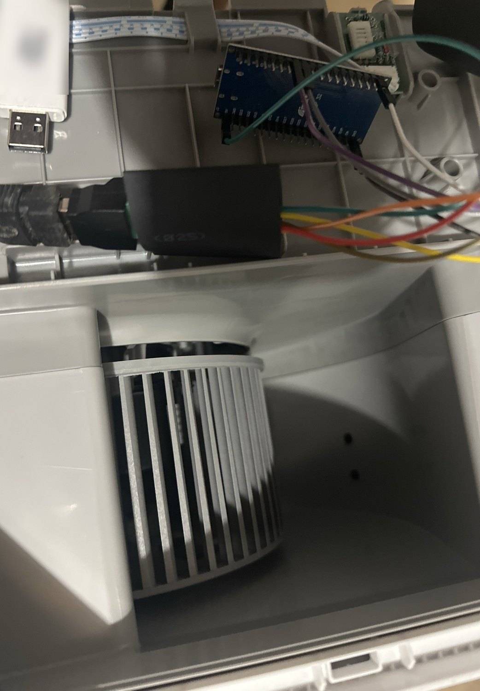
  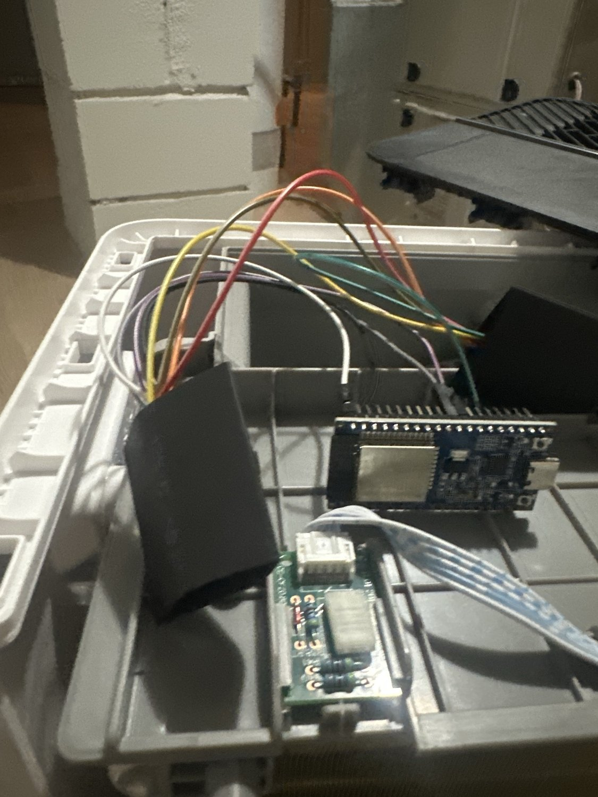
  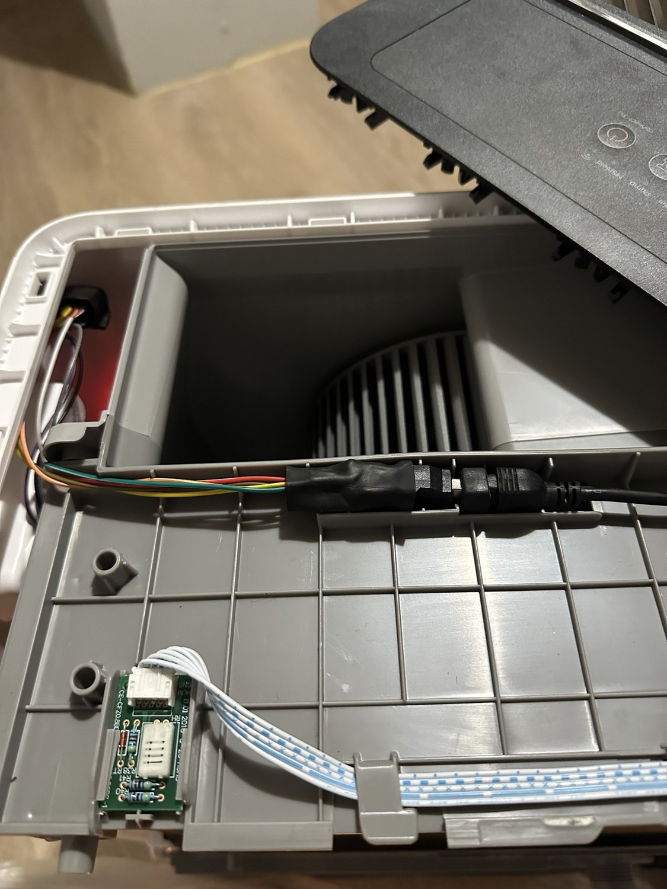
</p>

1. Top cover off. The stock dongle is a white USB stick; pull it out and keep it.
2. Plug a short USB extension into the port and the screw-terminal plug into that, so nothing hangs off the port.
3. One wide piece of heat-shrink goes over the level converter and the screw block together, shrunk with a hair
   dryer.
4. Route the wires along the frame, clear of the blower wheel. The ESP32 sits in the cavity beside it.
5. Cover back on. From the outside nothing has changed.

## Home Assistant and Apple Home

[`homeassistant/packages/dehumidifier.yaml`](homeassistant/packages/dehumidifier.yaml) has the on/off switch that
Apple Home gets, the status sensor, the run schedule and the two alerts.
[`homeassistant/packages/electricity_period.yaml`](homeassistant/packages/electricity_period.yaml) is the price
period it schedules by (my utility's time-of-use hours; change them to yours).
[`homeassistant/homekit.yaml`](homeassistant/homekit.yaml) is the HomeKit Bridge entry.

Why a switch and not a dehumidifier tile: HomeKit shows a Home Assistant climate entity as a thermostat, which would
be wrong, so Apple Home gets a plain on/off switch and a humidity sensor. The switch reads its state from the
unit, so pressing the power button on the panel flips the tile in Apple Home too. Mode, fan and target stay in Home
Assistant.

### It was short-cycling

Left on its own "Set 50%" mode, the unit started its compressor about 100 times a day: roughly 7 minutes on, 6.5
off, plain to see as ~390 W steps on my whole-house power meter. Its humidity reading sawed between 50 and 61% while
the rest of the house held 47-49%. The cause is where the sensor sits: in the unit's own airflow. With the
compressor off, the fan blows over the wet coil, some of the water just removed evaporates again, the reading climbs
and the compressor restarts.

So Home Assistant runs it in **Continuous** mode (compressor on the whole time) in one long run instead:

- at off-peak (midnight to 6 am), on nights the house air holds moisture (living room dew point 50°F or more), and
  every third night as a check otherwise;
- in the day only if the house stays damp for an hour, and never in on-peak hours;
- any run stops once the basement reads 50% (from 30 minutes in), and the firmware only publishes the humidity after
  20 minutes of running, because the reading of a stopped unit is the wet coil talking.

The first night: **one compressor start** instead of 17 in the same hours the night before, and about **0.23 kWh**
at the off-peak price against roughly **4.7 kWh a day** before.


<p align="center">
  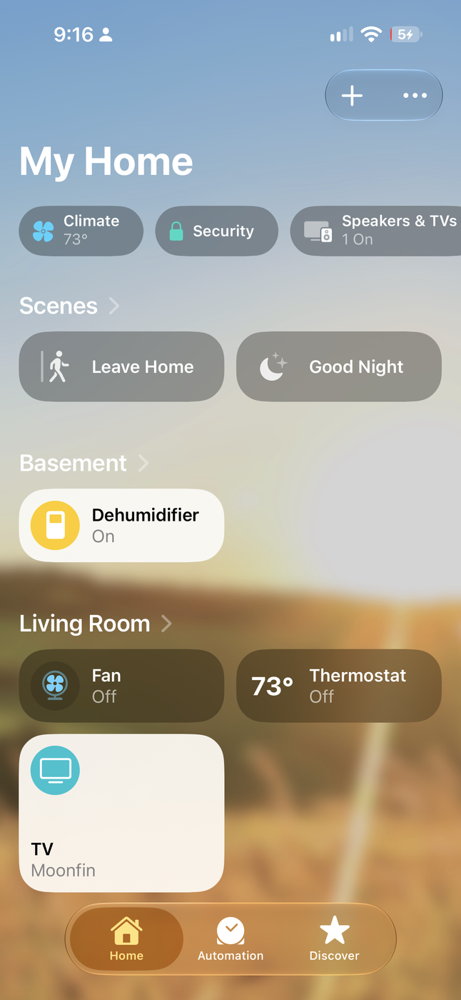
  
  
</p>

Asking Siri, with the unit's display following:

<p align="center">
  
  
  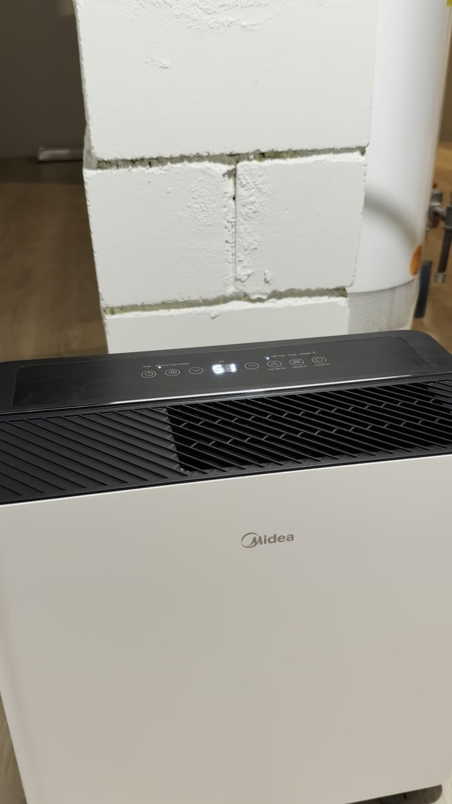
</p>

## Credits

- [Chreece](https://github.com/Chreece), who wrote and maintains
  [ESPHome-Dehumidifier](https://github.com/Chreece/ESPHome-Dehumidifier), the ESPHome component this runs on.
- [Zane Pickett (sirwolfgang)](https://github.com/sirwolfgang), who added the component's V2 protocol support
  ([#44](https://github.com/Chreece/ESPHome-Dehumidifier/pull/44)). This unit speaks V2, so that's the code it runs.
- [Hypfer](https://github.com/Hypfer), whose [esp8266-midea-dehumidifier](https://github.com/Hypfer/esp8266-midea-dehumidifier)
  worked out the protocol the component was ported from.
- [CDank](https://github.com/CDank), [sargas](https://github.com/sargas), [nbogojevic](https://github.com/nbogojevic)
  and the component's other contributors.

Thank you all.

## License

[MIT](LICENSE). This is a record of what worked on my unit. Opening a mains appliance is at your own risk.
